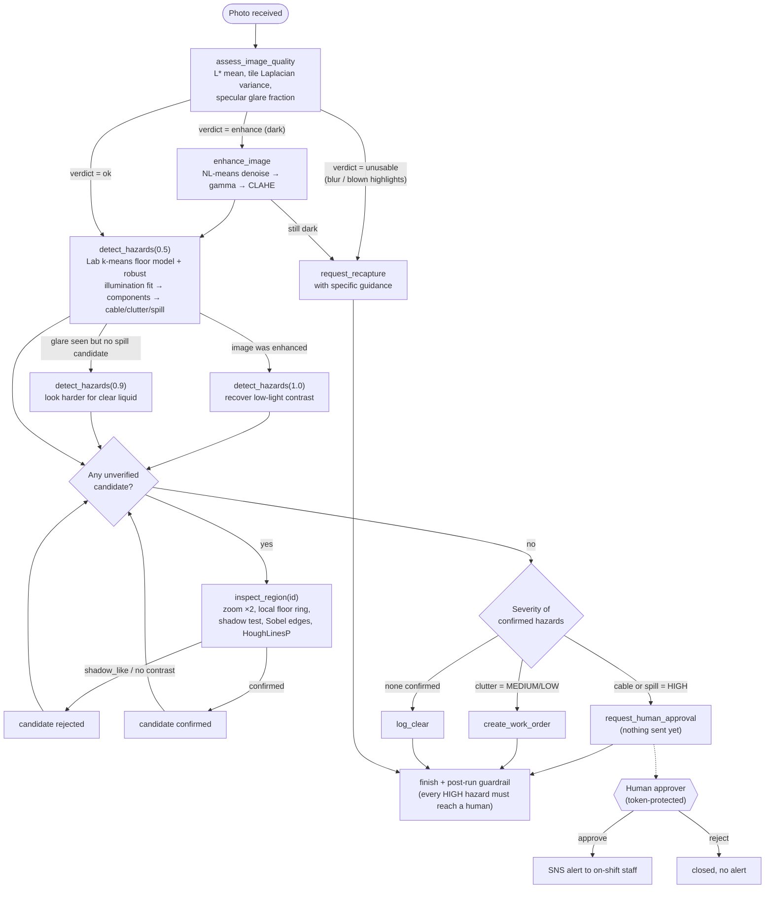

# HazardLens agent workflow (perception → decision → action)

Every decision node below branches on an **OpenCV 5 output**. That is what qualifies HazardLens
for the Agentic Vision path: the visual evidence decides which tool runs next and which action
(or human request) follows.

## Planners and control

| Concern | Mechanism |
|---|---|
| Who decides | `RulePlanner` (deterministic, default) or `LLMPlanner` (Claude `claude-sonnet-5-5` via Anthropic API, or Bedrock). Both call the *same* tool schema. |
| LLM failure | Any API error → logged `fallback` step → `RulePlanner` resumes from the current state. |
| Autonomy limits | Max 14 tool calls, max 6 inspections. Agent can only *request* urgent alerts. |
| Guardrail 1 | `create_work_order` with a HIGH hazard is re-routed to human approval. |
| Guardrail 2 | `log_clear` is refused while confirmed hazards exist. |
| Guardrail 3 | On `finish`, any confirmed HIGH hazard not in front of a human is auto-escalated. |
| Human control | `/api/approvals/{id}` needs `X-Approver-Token` (Secrets Manager) when configured. Only approved items reach SNS. |
| Observability | Each tool call → JSON log line (`run_id`, tool, planner, ms) + full trace in the response and in S3. CloudWatch metric filters count `Escalations` and `GuardrailInterventions`. |

## Example traces (from `eval/traces/`)

**Shadow dismissed (`scene_043`)**: quality ok → `detect_hazards(0.5)` finds a "clutter" candidate (conf 0.26)
→ `inspect_region(h1)` says `shadow_like` → `log_clear`. The single-shot pipeline files a needless work order.

**Low light (`scene_046`)**: quality `dark` → `enhance_image` → `detect_hazards(0.5)` → `detect_hazards(1.0)`
(because the image was enhanced) → `inspect_region` confirms a cable → `request_human_approval`.

**Blurry (`scene_052`)**: quality `unusable` (sharpness 7.5 < 40) → `request_recapture` with "hold the phone
still" guidance. No detection is attempted, so no decision is made on untrustworthy pixels.
