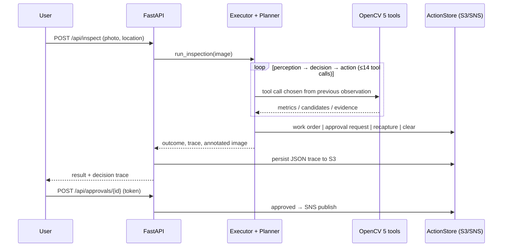

# HazardLens architecture

## System (OpenCV 5 + AWS + agent components)

```mermaid
flowchart LR
    U["Care worker / family member<br/>phone browser"] -->|"HTTPS* photo upload"| ALB
    subgraph AWS["AWS account (eu-west-2, CDK stack 'HazardLens')"]
        ALB["Application Load Balancer<br/>/healthz health checks"] --> SVC
        subgraph SVC["ECS Fargate service · ARM64 / Graviton · 1 vCPU, 2 GB"]
            API["FastAPI app<br/>upload validation, EXIF stripped by re-decode"]
            AG["Agent executor (Toolbox)<br/>state, budgets, guardrails"]
            PL["Planner<br/>RulePlanner (default) or Claude tool use"]
            CV["OpenCV 5.0 tools<br/>quality gate · enhance · detect · inspect_region · annotate"]
            API --> AG
            AG <--> PL
            AG <--> CV
        end
        AG -->|"JSON traces (no images)"| S3[("S3 trace bucket<br/>SSE-S3, block public, 30-day expiry")]
        AG -->|"approved alerts only"| SNS["SNS topic: HazardLens alerts"]
        SM["Secrets Manager<br/>approver token, optional Anthropic key"] -.-> SVC
        SVC -->|"structured JSON logs"| CWL["CloudWatch Logs<br/>metric filters: Escalations, GuardrailInterventions"]
        CWL --> CWA["CloudWatch alarms<br/>Target 5xx, UnhealthyHosts"] --> OPS["SNS ops topic"]
        BR["Amazon Bedrock (optional<br/>LLM_PROVIDER=bedrock)"]
    end
    PL -.->|"optional"| BR
    PL -.->|"optional ANTHROPIC_API_KEY"| ANT["Anthropic API<br/>claude-sonnet-5-5"]
    SNS --> STAFF["On-shift staff<br/>email / SMS subscriptions"]
    U -->|"Approve / reject"| API
```

\* The stack ships with an HTTP listener. Adding HTTPS needs a domain + ACM certificate (see TODO.md).

## Request lifecycle

Infrastructure as code: [`infra/hazardlens_infra/stack.py`](../infra/hazardlens_infra/stack.py).
